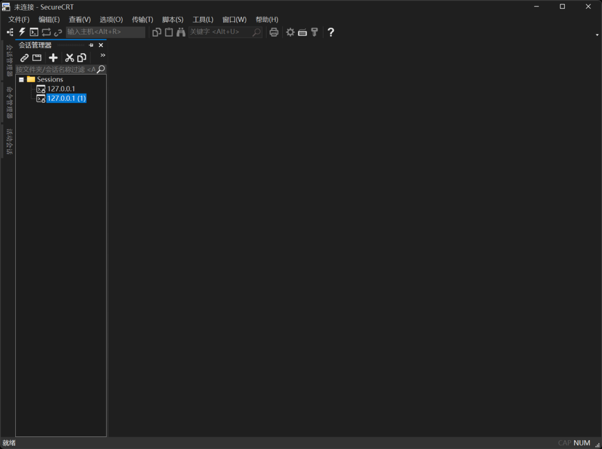

# secureCRT[9.7.3.3916] 汉化版

适用于 **SecureCRT 9.7.3.3916 x64** 的非官方简体中文资源补丁，汉化菜单、设置、连接窗口及提示信息。

审查 11,688 项文本，翻译 **6,039 项**，修改 9 个模块的 375 个资源。支持精确版本校验、备份、失败回滚及恢复英文。部分协议窗口和技术标识仍保留英文。



## 下载与使用

从 [Releases](https://github.com/klwb360/secureCRT-9.7.3.3916-zh-CN/releases/latest) 获取：

- **整合安装包 EXE**：运行安装器，默认安装到 `D:\SecureCRT`；已有精确匹配版本时只应用补丁。
- **汉化补丁 ZIP**：适合已经自行安装 **9.7.3.3916 x64** 原版的用户。
- **SHA256SUMS.txt**：用于校验下载文件。

使用补丁 ZIP 时先退出 SecureCRT，解压后在文件夹打开 Windows PowerShell，运行：

```powershell
powershell.exe -NoProfile -ExecutionPolicy Bypass -File .\apply.ps1
```

默认程序目录为 `D:\SecureCRT`，其他目录可传入 `-InstallDir`。恢复英文：

```powershell
powershell.exe -NoProfile -ExecutionPolicy Bypass -File .\restore.ps1
```

备份默认保存在 `%LOCALAPPDATA%\SecureCRT-zh-CN`，请保留备份。整合安装包用户使用安装日志记录的 `restore-local.ps1` 恢复；恢复程序文件时保留后来新增的会话。

## 说明

- 本项目不提供许可证，不延长试用期，不修改授权或协议签名校验。
- 修改资源会使相关文件的原有数字签名失效；受保护的协议 DLL、授权/更新程序及控制台模块保持原文件。
- 已通过 21 项本机自动测试、应用/恢复演练和本机 SSH 验证；未完成干净 Windows 系统的新装、真实串口通信或完整 SFTP 传输验收。
- 整合安装包为自制未签名版本，内嵌原版安装程序的 VanDyke 签名有效；原版许可继续适用。
- Git 仓库提供差分补丁、脚本及说明，安装 EXE 放在 Releases。公开内容不含用户配置、密钥或私有备份。

更多信息：[使用与恢复](docs/USAGE.md) · [验证范围](docs/VERIFICATION.md) · [翻译清单](docs/translations.csv)
