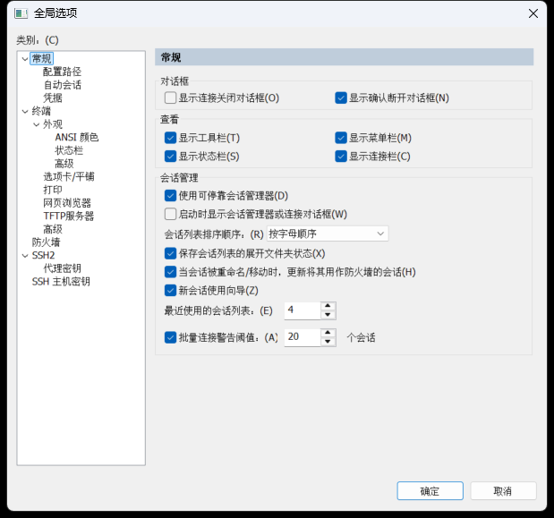

# 验证范围

版本：9.7.3.3916，x64。审查 11,688 项目录条目，翻译 6,039 项；375 项资源、9 个模块。翻译数字包含重复条目，不表示每个窗口都已经打开验收。

修改模块：BCGCBPRO3620u143.dll、ClientConfigUI97U.dll、CommonUI97U.dll、ConnectDialog97U.dll、LicenseUI97U.dll、SecureCRT.exe、SSH2Client97U.dll、SSH2Core97U.dll、TLSCore97U.dll。

本机已验证：

- 21 项自动测试，包括版本/哈希拒绝、资源结构、占位符/变量/换行、签名保护边界、突然终止后的恢复、锁文件自动回滚、缓存失败回滚、幂等执行以及保留新增会话。
- 修改资源全部编译，非资源代码节、导入导出、清单、功能标识及控件编号保持一致；只在已有空隙内加宽少数静态标签。
- 正式安装目录执行应用→恢复→再次应用；恢复后 162 个原程序文件哈希一致，官方签名有效。最终 153 个其他程序文件保持一致，18 个协议/安全/控制台模块保留有效签名。
- 第二屏上的主菜单、会话管理、快速连接、全局/会话选项、公钥认证与串口设置窗口；保存后重新打开测试会话。
- 仅在本机回环地址进行 SSH 指纹核对、密码认证和中文欢迎信息验证；SFTP 提示符可打开。

未验证：干净 Windows 系统全新安装、真实串口通信、外部设备连接、完整 SFTP 传输、TLS 实连、授权激活、全部低频窗口以及所有缩放组合。

保留英文：受签名校验限制的协议模块；授权/更新帮助程序；控制台接口；Default/None/Custom 等功能值；算法、命令、脚本和环境变量；未确认用途的 ANSI 初始化值；系统及非资源区动态文本。未宣称百分之百汉化。

初稿包含静态文本机器翻译，并经术语及资源定位校对；未宣称逐句专业人工审定。公开材料中不包含用户配置及私有运行日志。

